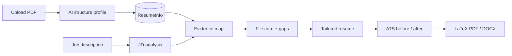

# ATS Beater (GobioGo) — Project Summary

**Shareable product overview** for teammates, investors, partners, and new contributors.

---

## What it is

**ATS Beater** is an AI-powered SaaS that turns a base resume + a job description into a **role-specific, ATS-friendly resume PDF** (plus cover letter, interview prep, and application tracking).

| | |
|--|--|
| **Product name** | ATS Beater |
| **Code / repo name** | GobioGo |
| **One-line pitch** | Paste a JD → get an honestly tailored, scored resume you can actually submit — not a generic rewrite that invents skills. |

---

## The problem it solves

Most candidates either:

1. Send the **same resume** to every job (weak ATS match), or
2. Use AI tools that **hallucinate** tools, titles, and metrics (Okta, “Senior”, fake numbers) → might pass ATS, then fail interviews

ATS Beater aims for **honest max-match**:

- Reframe and amplify what the candidate really has
- Mirror JD keywords only when evidence exists
- Show **Fit Score + gaps** so users know when a role is a stretch

---

## Who it’s for

- Job seekers applying to many roles who need **fast, tailored PDFs**
- Candidates who care about **ATS keywords** but refuse fake claims
- People who want **tracker + cover letter + interview prep** in one place
- Admins / coaches managing packs, promos, and org labels

---

## Core user flow

```text
Google login
  → Upload resume PDF
  → AI structures your profile (editable)
  → Paste job description (or capture via browser extension)
  → Optional: Analyze Fit (score + gaps)
  → Generate tailored resume (uses 10 credits)
  → Review Fit / ATS, edit, chat, cover letter, interview pack
  → Download PDF / DOCX
  → Track application status until offer
```

### Technical generation pipeline

1. **JD analysis** — must-haves, keywords, seniority  
2. **Evidence map** — each requirement: Supported / Partial / Missing  
3. **Fit verdict** — Strong / Stretch / Mismatch + score 0–100  
4. **Resume write** — headline, summary, rewritten bullets (Pro model)  
5. **ATS score + refine** — before → after score; one polish pass if needed  
6. **LaTeX → PDF** — compile + optional cloud storage  



---

## Why use it

| Benefit | What you get |
|--------|----------------|
| Better shortlists | JD-aligned headline, summary, bullets, skills order |
| Trust | No inventing tools/years you don’t have |
| Clarity | Fit Score + red gaps before you waste applications |
| Speed | Minutes from JD → PDF instead of rewriting by hand |
| Completeness | Cover letter, DOCX, interview pack, tracker |
| Habit | Daily free credits + application board so users return |

---

## All features

### Auth & account

- Google OAuth → JWT session
- Dev auth bypass for local development
- Onboarding / new-user detection
- **Account data export** (JSON download)
- **Account delete** (hard delete user data)
- In-app **notifications** (e.g. resume ready)

### Profiles (base resume)

- Upload PDF → text extract or vision fallback
- AI structures a full profile (`ResumeInfo`)
- Edit profile in the dashboard
- AI enhance (rate-limited free enhancements per day)
- Soft delete
- Profile chat assistant

### Jobs & tailored resumes (core product)

- Create job with company / role / job description
- **Analyze fit** (free pre-check before spending a credit)
- **Generate resume** (10 credits) via multi-pass tailor pipeline
- Fit Score, Fit Label, gap list, evidence checklist
- ATS score **before → after**
- Headline + professional summary on the PDF
- Security / auth skill category when relevant
- Manual JSON edit
- AI **chat editor** for tweaks
- Free **PDF recompile** after edits
- **DOCX** export
- Version history + restore
- Keyword **gap fixer** (amplify Supported / Partial only — never invent Missing tools)
- **Cover letter** generation
- **Interview packet** (likely questions, STAR stories, elevator pitch, gaps to study)
- PDF download (cloud signed URL or local file)

### Application tracker

- Pipeline: Saved → Applied → Interview → Offer / Rejected / Withdrawn
- Board UI at `/dashboard/tracker`
- Notes + follow-up dates
- Fit / ATS scores visible on cards

### Resume roast (growth / viral)

- Upload resume → humorous roast + serious ATS checklist
- Public shareable link
- CTA to convert: “Fix this for a real JD”

### Browser extension

- Chrome extension scaffold (`extension/` folder)
- Capture JD from job pages → create job in ATS Beater
- API: `POST /extension/capture-job`

### Credits & payments

- **100 signup credits** on first Google OAuth signup (configurable via `SIGNUP_BONUS_CREDITS`)
- Daily free credit pool (configurable; default **20 credits/day** UTC — ~2 tailors)
- **10 credits per tailored resume** (configurable via `RESUME_GENERATION_CREDIT_COST`)
- Purchasable credit packs: Starter 500@₹279 · Sprint 1,200@₹599 · Job Hunt 2,500@₹949 (same features — credits only)
- Unlimited **time passes** (stackable expiry)
- Promo codes (credits or time pass)
- Spend priority: active time pass → daily free pool → purchased balance → paywall (HTTP 429)
- Split deduction when daily pool partially covers cost
- Refund full cost if resume generation fails (except unlimited time-pass usage)
- **Job Hunt Pro** subscription: 800 credits/month (~80 tailors) @ ₹299 + tracker / interview / extension

### Admin (super admins)

- Tenants + email-domain auto-assign (**org labeling only**, not data isolation)
- Users, credit packs, time passes, promo codes
- Grant credits, transaction ledger
- LLM usage analytics
- Roast share analytics

### Platform

- FastAPI backend + Next.js frontend
- PostgreSQL + Alembic migrations
- Background generation tasks
- Stuck-job recovery on server restart
- Optional Google Cloud Storage for PDFs
- Health check and Cloud Run deploy scripts

---

## What it deliberately does *not* do

- Invent skills/tools (e.g. Okta, SAML) the candidate never used just to hit “100% keyword match”
- Claim “Senior” when experience doesn’t support it
- Guarantee interviews (Fit Score is guidance, not a promise)
- Full multi-tenant data isolation (tenants are organizational labels)

---

## Honest product principle

| Scenario | Expected behavior |
|----------|-------------------|
| Strong role match (e.g. Full-Stack JD + Full-Stack profile) | High Fit / ATS; resume feels clearly written for *that* job |
| Stretch / mismatch (e.g. Senior IAM JD + junior Full-Stack profile) | Stretch or Mismatch label; red gaps; transferable framing only; **no fake Okta/SAML** |

World-class means: **aligned roles → shocked at quality**; **misaligned roles → protected from false confidence**.

---

## Tech stack

| Layer | Technology |
|-------|------------|
| Backend | FastAPI, SQLAlchemy (async), PostgreSQL, Alembic |
| AI | Gemini Flash (structure / analysis), Gemini Pro (tailoring), Google ADK (chat) |
| PDF | pdfplumber, LaTeX (`resume.cls`) + pdflatex |
| Frontend | Next.js (App Router), React, Zustand, TanStack Query |
| Auth | Google OAuth → JWT |
| Payments | Razorpay |
| Storage | Google Cloud Storage (optional) |
| Tooling | UV (Python), npm (frontend) |

---

## Monetization

1. **Free daily credits** — trial and habit  
2. **Credit packs** — impulse buys during active job hunts  
3. **Time passes** — unlimited generation for N days  
4. **Job Hunt Pro subscription** — predictable monthly usage + premium feature bundle  
5. **Promo codes** — campus, influencer, and partnership growth  

Users pay when generation quality + Fit/ATS feedback make the next application feel worth a credit.

---

## Mental model

**ATS Beater = a job-hunt OS for resumes:**

> Structure once → tailor per JD with honesty + scores → edit → PDF/DOCX → cover letter + interview prep → track until offer.

---

## How to run (local)

```bash
# Database
docker compose up -d

# Backend
uv sync --extra dev
uv run alembic upgrade head
uv run uvicorn app.main:app --reload --port 8000

# Frontend
cd frontend && npm run dev
# → http://localhost:3000
```

Set `DEV_AUTH_BYPASS=true` in `.env` to skip Google OAuth during development.

---

## Document info

| | |
|--|--|
| **Purpose** | Shareable product / project summary |
| **Audience** | Team, investors, partners, new engineers |
| **Product** | ATS Beater (GobioGo) |
