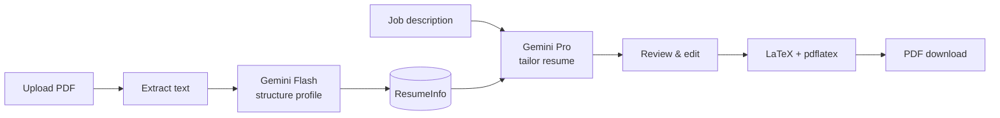

# GobioGo

**Match your resume to the job description — then ship a tailored PDF.**

GobioGo is a full-stack app that turns a base resume plus a pasted job description (JD) into an ATS-friendly, keyword-aligned resume. Upload a PDF, let AI structure your profile, tailor content for each role, review edits in the UI (including an AI chat assistant), and compile a clean LaTeX PDF.

Repository: [github.com/Anup-Chaurasiya/JD-matcher](https://github.com/Anup-Chaurasiya/JD-matcher)

## What it does



**Phase 1 — Tailoring:** Structured profile + JD → tailored `CustomResumeInfo` (editable before PDF).

**Phase 2 — PDF:** LaTeX builder + `resume.cls` → `pdflatex` → downloadable PDF.

**Extras:** Free **resume roast** (ATS checklist + shareable link), **credits / Razorpay** for generation limits, **admin** for tenants, promos, and packs.

### Job status

`PENDING` → `GENERATING_RESUME` → `RESUME_GENERATED` → `GENERATING_PDF` → `READY` (or `FAILED` at any step).

## Stack

| Layer | Technology |
|-------|------------|
| API | FastAPI, SQLAlchemy (async), PostgreSQL, Alembic |
| AI | `google-genai` (Flash for structure/roast, Pro for tailoring), Google ADK for chat |
| PDF | pdfplumber, pdflatex + `resume.cls` |
| Web | Next.js (App Router), React, Zustand, TanStack Query |
| Auth | Google OAuth → JWT |
| Payments | Razorpay (optional) |
| Storage | Google Cloud Storage (optional) |
| Tooling | [UV](https://docs.astral.sh/uv/) |

Use current Gemini preview models (`gemini-3-flash-preview`, `gemini-3.1-pro-preview`) — older 2.5 preview IDs are deprecated.

## Quick start

### Prerequisites

- Python **3.12+**
- **Docker** (PostgreSQL)
- **TeX Live** with `pdflatex` (macOS: `brew install --cask mactex`)
- **Poppler** for roast PDF previews (macOS: `brew install poppler`)
- **UV**: `curl -LsSf https://astral.sh/uv/install.sh | sh`
- **Node.js 20+** for the frontend

### Run locally

```bash
git clone https://github.com/Anup-Chaurasiya/JD-matcher.git
cd JD-matcher   # or your local folder name (e.g. GobioGo)

cp .env.example .env
# Fill in GEMINI_API_KEY, JWT_SECRET, and OAuth keys (or use DEV_AUTH_BYPASS)

docker compose up -d
uv sync --extra dev
uv run alembic upgrade head

# Terminal 1 — API
uv run uvicorn app.main:app --reload --port 8000

# Terminal 2 — UI
cd frontend && npm install && npm run dev
```

- App: **http://localhost:3000**
- API: **http://localhost:8000** (OpenAPI at `/docs`)
- Set `DEV_AUTH_BYPASS=true` in `.env` to skip Google OAuth in development.

### Keys you need

| Variable | Purpose |
|----------|---------|
| `GEMINI_API_KEY` | [Google AI Studio](https://aistudio.google.com/apikey) |
| `GOOGLE_CLIENT_ID` / `GOOGLE_CLIENT_SECRET` | OAuth (production) |
| `JWT_SECRET` | Token signing |
| `RAZORPAY_*` | Payments (optional) |
| `GCS_BUCKET` | PDF persistence (optional; local dev works without) |

See `.env.example` for the full list.

## Tests

```bash
# Unit tests (SQLite in-memory, no external services)
uv run pytest tests/ -v --ignore=tests/integration

# Smoke tests (DB, Gemini, LaTeX, GCS)
INTEGRATION=1 uv run pytest tests/integration/ -v
```

## Project layout

```
app/
  main.py              # FastAPI app
  api/                 # Routes (auth, profiles, jobs, credits, roasts, admin)
  models/              # SQLAlchemy ORM
  schemas/             # Pydantic models
  services/            # AI, OCR, LaTeX, jobs, credits, chat, payments, storage
frontend/
  app/                 # Next.js pages (landing, dashboard, roast share)
  lib/                 # API client, stores
tests/                 # Unit + integration tests
alembic/               # Migrations
resume.cls             # LaTeX document class
infra/                 # Docker, Cloud Run deploy, preflight
```

## Credits (how generation is billed)

1. Active **time pass** → unlimited  
2. **Daily free** credits (default 3/day, UTC midnight reset)  
3. **Purchased** balance  
4. None left → `429` and paywall in the UI  

Credits deduct **before** background generation; failed runs trigger a **refund** (except during an active time pass).

## Admin access

Grant yourself super-admin in the database:

```sql
UPDATE users SET is_super_admin = true WHERE email = 'you@example.com';
```

Then use the **Admin** section in the dashboard for users, tenants, domain rules, packs, promos, and transactions.

**Tenants** label organizations (e.g. assign `@company.com` on signup). Data stays scoped per user — tenants are not a security boundary.

## Deployment

```bash
docker build -t gobiogo .
docker run -p 8080:8080 --env-file .env gobiogo
```

Cloud Run: configure `GCP_PROJECT_ID` and run `bash infra/deploy-cloudrun.sh`.

Oracle Cloud (VM + Docker Compose): see [infra/DEPLOY.md](infra/DEPLOY.md) and run `./infra/deploy-oracle.sh --migrate --preflight` on the VM.

Pre-flight check before production:

```bash
uv run python infra/preflight.py
```

Production needs PostgreSQL, OAuth redirect URIs matching `FRONTEND_URL`, and optionally GCS + Razorpay.

## Troubleshooting

| Issue | What to try |
|-------|-------------|
| LaTeX timeout | More CPU/RAM on the host; check `LATEX_BIN_PATH` |
| Invalid PDF upload | Real PDF only (not renamed DOCX/images) |
| OAuth redirect error | `FRONTEND_URL` must match Google Console redirect URI exactly |
| Chat “already in progress” | Refresh the page to clear stale in-memory task state |

## API overview

Interactive docs: **http://localhost:8000/docs** when the API is running.

Main groups: `/auth`, `/profiles`, `/jobs`, `/roasts`, `/credits`, `/payments`, `/admin/*`, plus SSE progress where applicable.

## License

MIT — see [LICENSE](LICENSE).

---

Maintained by [Anup Chaurasiya](https://github.com/Anup-Chaurasiya).
